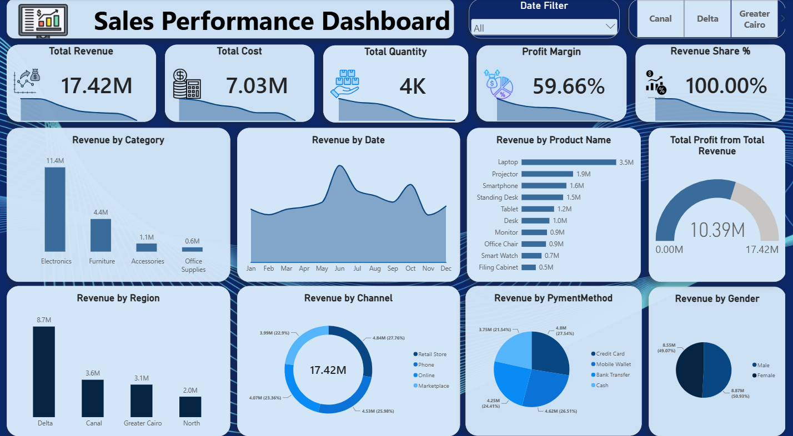

# Sales Performance Analysis

## Project Overview
This project analyzes sales data using SQL Server and Power BI to evaluate revenue performance across product categories, regions, customers, payment methods, and time.

The goal is to extract meaningful business insights and support data-driven decision-making.

## Business KPIs

| KPI | Value |
|---|---:|
| Total Revenue | 17.42M |
| Total Cost | 7.03M |
| Total Profit | 10.39M |
| Profit Margin | 59.66% |
| Total Quantity Sold | Approximately 4K |

## Dashboard Preview

**View Interactive Dashboard:** [Open Power BI Dashboard](https://app.powerbi.com/groups/dd57b92d-9409-4eb3-8fae-895f33460213/reports/c18d4c1e-80a2-45d9-96b8-866a746f473c/444e5917e276213b7532?experience=power-bi)

## SQL Analysis

- **Revenue by Category:** Compared total revenue across product categories.
- **Revenue by Region:** Evaluated sales performance across different regions.
- **Top 10 Products:** Identified the products generating the highest revenue.
- **Top 10 Customers:** Identified the customers contributing the most revenue.
- **Revenue by Gender:** Compared revenue across customer genders.
- **Revenue by Payment Method:** Analyzed revenue by payment method.
- **Yearly Revenue Trends:** Examined annual revenue to understand sales performance over time.

## Tools & Technologies

- **SQL Server:** Data querying, aggregation, joins, grouping, and sorting.
- **Power BI:** Interactive dashboards and data visualization.
- **CSV:** Data storage and exchange.

## Key Objectives

- Evaluate overall sales performance.
- Identify high-performing products and categories.
- Understand regional and customer revenue patterns.
- Analyze payment methods and yearly sales trends.
- Present business data through clear visualizations.

## Conclusion

This project demonstrates practical SQL analysis and Power BI visualization to explore sales data, evaluate business performance, and communicate insights that support data-driven decisions.

## Connect with Me

- **LinkedIn:** [Youssef Yousri](https://linkedin.com/in/youssefyousri-analyst)
- **GitHub:** [youssefyousri](https://github.com/youssefyousri)
